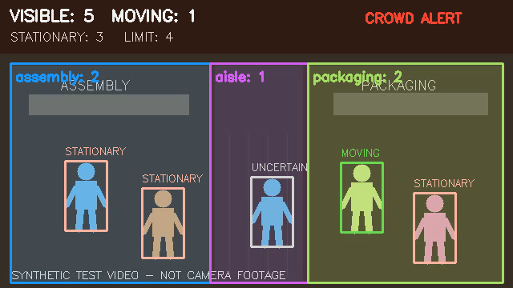
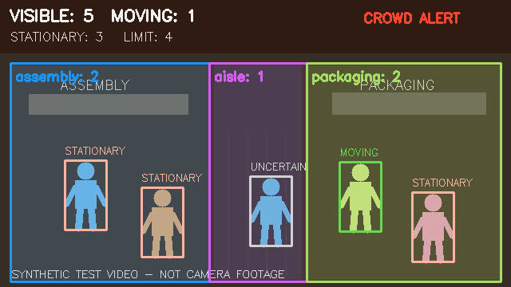

# Workshop Vision AI


### Management Dashboard

The Streamlit dashboard displays workshop occupancy, movement statistics, zone activity and crowd alerts.


**Anonymous Workplace Occupancy & Movement Dashboard**  
**Developed by Saman Farshad**

A practical computer-vision portfolio project using Python, OpenCV, YOLO11, pandas and Streamlit. It detects visible people from video/camera input, counts people in workshop zones, estimates motion, warns about crowding and displays aggregate reports.


## Features

- Person detection on a **real camera or video** with YOLO11n (`--detector yolo`)
- Separate **fully synthetic demo** with pre-generated boxes (`--detector demo`) — **does not run YOLO**
- Current visible people and peak occupancy (not payroll headcount)
- Polygon-based zone counts: assembly, aisle, packaging
- Short-term anonymous tracking for **moving / stationary / uncertain** movement states
- Crowd alert when current visible count exceeds the configured limit
- CSV reports containing only aggregate counts, plus Streamlit dashboard
- No face recognition, employee naming, per-person reports, audio or camera video recording

## Stack

Python 3.11 · OpenCV · NumPy · Ultralytics YOLO11 · pandas · Streamlit

## Quick start — Windows PowerShell

Run these commands **from the project folder**:

```powershell
py -3.11 -m venv .venv
.\.venv\Scripts\Activate.ps1
python -m pip install -r requirements.txt
python make_demo.py
python monitor.py --source data/demo_workshop.mp4 --detector demo --demo-preview
python -m streamlit run dashboard.py
```

A video window will open on the demo run. Press **Q** to close, or let it finish. If your system cannot open a video window, use `--no-window`.

### Use your webcam

```powershell
python monitor.py --source 0 --detector yolo
```

### Use your own video

```powershell
python monitor.py --source "path/to/video.mp4" --detector yolo
```

**Important:** YOLO model weights (`yolo11n.pt`) download on first use, so internet is required once. The synthetic demo does not require model weights and works offline after dependencies are installed. Camera use requires appropriate permission. This is **not production-ready surveillance software**.

### Run without a display

```powershell
python monitor.py --detector demo --no-window
```

### Run automated tests

```powershell
python -m pip install pytest
python -m pytest -q
```

## Reports

- `data/reports/latest_report.csv` — time, visible people, movement-state counts, zone counts and crowd alerts only.
- `assets/demo_preview.png` — an image created **only from synthetic demo frames**.
- `data/demo_workshop.mp4`, `data/demo_boxes.json` — reproducible example assets from `make_demo.py`.

For real camera/video input, raw frames and images are **not saved by this program**. Video frames are still processed in local memory and may contain personal data. Real camera streams and report files should be secured and their use legally assessed.

## Configure zones

Edit `config/zones.json`. Each polygon point is normalized `[x, y]`, from 0 to 1. Zones must be calibrated to your own camera view. Set `max_people` to your intended crowd threshold. Note: the supplied demo zones are *not* calibrated for your camera.

## Meaning of movement states

- `moving`: the detected position changed enough over a short time window.
- `stationary`: little displacement was detected. A seated worker can be actively working while stationary.
- `uncertain`: too little history is available for a meaningful motion estimate.

Motion **does not** measure productivity, work effort, alertness, safety compliance, employee attendance or employment status. The people counted are **visible detections**, which may include visitors and may miss occluded people. Tracking is approximate; it is not identity recognition.

## Privacy and German workplace rules

This project is intended as a **technical portfolio demo**. In Germany, ongoing workplace surveillance used to monitor employee performance or behavior is generally not permitted. Any workplace camera use requires a separate lawful basis, necessity/proportionality assessment and relevant employee/works-council safeguards. Never film private/quiet areas. A project without facial recognition is **not automatically GDPR-compliant**.

Guidance: [German data protection authorities — video surveillance](https://www.baden-wuerttemberg.datenschutz.de/orientierungshilfe-videoueberwachung-nicht-oeffentlich/).

## License note

Original project code is MIT licensed (see `LICENSE`). **Ultralytics** is an independent dependency distributed under **AGPL-3.0** with a separate enterprise licensing option; inspect its terms before business deployment: https://github.com/ultralytics/ultralytics.

---

**GitHub:** [saman-farshad](https://github.com/saman-farshad)  
**Author:** Saman Farshad
